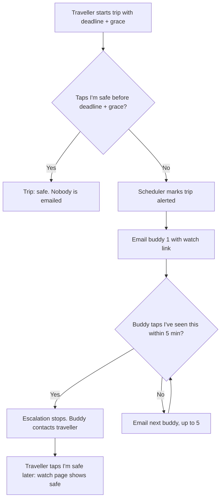

# Safe-Arrival Buddy

A calm, privacy-friendly way to let people know you got home safely.

Instead of tracking your location, you set a deadline ("home by 9:15 pm") and tap **I'm safe** when you arrive. If the deadline plus a grace period passes with no tap, the server emails your trusted buddies one after another until someone responds.

**Live demo:** https://safe-arrival-buddy.vercel.app/
**API docs (Swagger):** https://safe-arrival-api.onrender.com/docs

> The backend runs on a free hosting plan that sleeps when idle. The first request after a quiet period can take up to a minute.

---

## The problem

When someone travels late, the people who care about them keep asking "Reached?". Phones die, people forget to text, and live-tracking apps are heavy on privacy and unreliable in the background. This affects students, children, elderly people, night-shift workers and anyone walking home.

## How it works

1. **Add buddies.** The traveller adds up to 5 buddies by name and email. Each buddy receives a request and must **accept** before they can ever be alerted.
2. **Start a trip.** The traveller sets an arrival time and a grace period (default 10 minutes).
3. **Tap "I'm safe".** One tap closes the trip. Nobody is emailed.
4. **Or don't.** When the deadline plus grace passes, the trip becomes **alerted** and buddy 1 is emailed a live link.
5. **Escalation.** If buddy 1 doesn't tap **I've seen this** within 5 minutes, buddy 2 is emailed, and so on, up to buddy 5.
6. **Live watch page.** Each buddy's link opens a page that shows the trip status and updates by itself. No account is needed. If the traveller taps "I'm safe" later, the page flips to "safe".



## Features

- Register and log in (bcrypt password hashing, JWT)
- Up to 5 buddies per traveller, each confirmed by email before they can be alerted
- Trips: create, extend, mark safe, delete, with a clear state machine
- Background scheduler that checks for overdue trips every 30 seconds
- Ordered escalation across buddies with a delivery log of every email attempt, with retry on failure
- Public watch page for buddies (no account), with an "I've seen this" button
- Revoke a buddy at any time, and their links stop working
- Demo mode that shrinks "minutes" to "seconds", so a reviewer can watch a full escalation in about a minute
- 74 automated tests

## Privacy and security choices

- **No location tracking.** Only a deadline and a check-in.
- **Tokens are never stored.** Buddy confirmation and watch links use `secrets.token_urlsafe(32)`. Only the SHA-256 hash is stored, and the raw token is emailed once.
- **Links expire and can be revoked.** Confirmation links are single-use and expire after 48 hours.
- **Buddies must opt in.** Only buddies who accepted the request are ever emailed.
- **Ownership is enforced.** A user asking for another user's trip or buddy gets a 404, and this is tested.
- **Same error for every bad link,** so tokens can't be probed.
- **Scheduler is idempotent.** A trip moves from active to alerted exactly once, so a double run never sends double alerts.
- **All times are stored in UTC.** The frontend converts to local time.

## Tech stack

| Layer | Choice |
|---|---|
| Backend | Python, FastAPI |
| Database | SQLAlchemy 2.0. SQLite locally, PostgreSQL (Supabase) in production |
| Auth | bcrypt, JWT (PyJWT), hashed one-time tokens for buddies |
| Scheduler | An asyncio loop started with the app |
| Email | Brevo HTTPS API in production, Gmail SMTP for local use, console output when neither is set |
| Frontend | React, Redux Toolkit, React Router, Vite |
| Quality | pytest (74 tests), Swagger docs at `/docs`, demo mode |
| Hosting | Render (API), Vercel (frontend), Supabase (database) |

## Project structure

```
safe-arrival-buddy/
├── backend/
│   ├── app/
│   │   ├── main.py            # FastAPI app, CORS, scheduler startup
│   │   ├── config.py          # settings from environment variables
│   │   ├── models.py          # User, Buddy, Trip, DeliveryLog
│   │   ├── trip_rules.py      # the only place trip status changes are allowed
│   │   ├── alerts.py          # overdue check, escalation, retries
│   │   ├── scheduler.py       # background loop
│   │   ├── mailer.py          # Brevo / SMTP / console email sender
│   │   ├── notifications.py   # buddy confirmation email
│   │   └── routers/           # auth, buddies, trips, users, watch, demo
│   └── tests/
└── frontend/
    └── src/                   # pages, components, Redux slices, api.js
```

## Run it locally

You need Python 3.12 and Node.js.

**Backend** (Windows Command Prompt):

```
cd backend
python -m venv .venv
.venv\Scripts\activate
pip install -r requirements.txt
copy .env.example .env
uvicorn app.main:app --reload
```

On macOS or Linux, activate with `source .venv/bin/activate`. Swagger is at http://127.0.0.1:8000/docs.

**Frontend** (second terminal):

```
cd frontend
npm install
npm run dev
```

Open http://localhost:5173.

Without email settings, "emails" are printed in the backend terminal as `[DEV EMAIL]`, including the accept and watch links.

**Tests:**

```
cd backend
pytest
```

## Environment variables (backend)

| Variable | Purpose |
|---|---|
| `SECRET_KEY` | Signs login tokens. Use a random 64-character value |
| `DATABASE_URL` | Defaults to local SQLite. Use the PostgreSQL URL in production |
| `FRONTEND_URL` | Public frontend address, used in email links and CORS. No trailing slash |
| `BREVO_API_KEY` | Enables email through Brevo |
| `SMTP_FROM` | Sender address (must be verified in Brevo) |
| `SMTP_HOST`, `SMTP_PORT`, `SMTP_USER`, `SMTP_PASSWORD` | Optional Gmail SMTP for local use |
| `ESCALATION_MINUTES` | Wait before alerting the next buddy (default 5) |
| `DEFAULT_GRACE_MINUTES` | Default grace period (default 10) |
| `DEMO_MODE` | `true` makes every "minute" last one second |

Frontend: `VITE_API_URL` is the backend's public address.

Never commit `.env`.

## Try the escalation in under two minutes

1. Set `DEMO_MODE=true` on the backend and restart it.
2. Register and add two buddies with different inboxes you can open. Accept both.
3. Create a trip due in a few seconds and don't tap "I'm safe".
4. Buddy 1 is emailed, and then buddy 2 shortly after if buddy 1 doesn't tap "I've seen this".
5. Tap "I'm safe" on the trip. Both watch pages switch to "safe".

## API overview

Full interactive documentation is at `/docs`.

| Area | Endpoints |
|---|---|
| Auth | `POST /auth/register`, `POST /auth/login`, `GET /me` |
| Buddies | `GET/POST /buddies`, `POST /buddies/{id}/resend`, `DELETE /buddies/{id}`, `POST /buddies/confirm` (public) |
| Trips | `GET/POST /trips`, `GET/DELETE /trips/{id}`, `POST /trips/{id}/safe`, `POST /trips/{id}/extend`, `GET /trips/{id}/deliveries` |
| Watch (public) | `GET /watch/{token}`, `POST /watch/{token}/ack` |
| System | `GET /health` |

## Known limitations

- The scheduler runs inside the API process, so run a single instance. Several workers would duplicate checks.
- Free hosting sleeps when idle. A monitor pinging `/health` every 5 minutes keeps it awake.
- Emails from a new sender can land in spam. Buddies should check there.
- Alerts are emailed. SMS and Telegram are planned (the sender is isolated in `mailer.py`).
- Buddy order is the order they were added.
- Database tables are created automatically at startup. A migration tool such as Alembic would be the next step for schema changes.

## Future scope

- SMS and Telegram alerts (the email sender is isolated in `mailer.py`, so new channels plug in there)
- Share the watch link through WhatsApp
- Email confirmed buddies the watch link when a trip starts, not only when it becomes overdue
- Let travellers reorder their buddies
